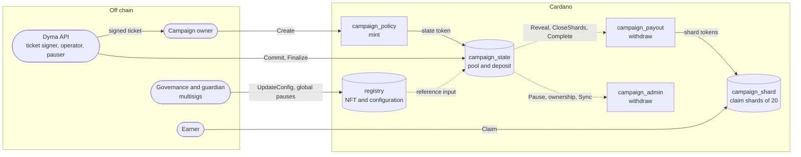
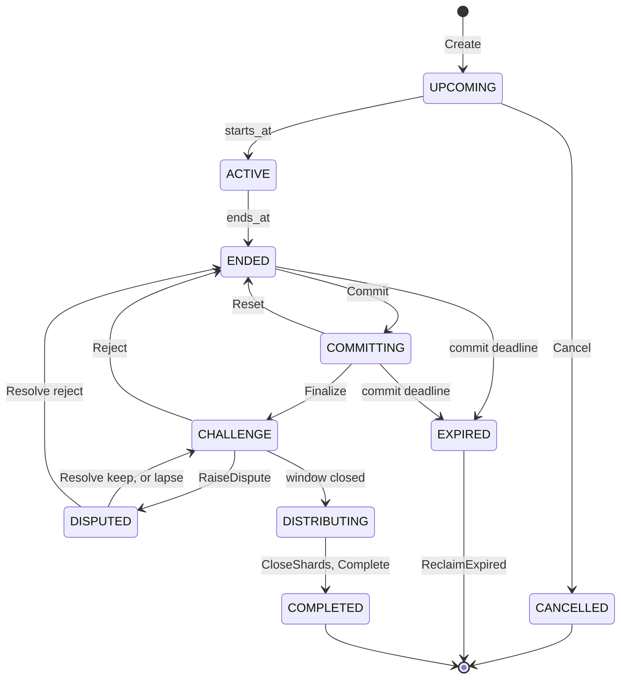

<div align="center">

<picture>
  <source media="(prefers-color-scheme: dark)" srcset=".github/assets/dyma-utxo-lockup-on-dark.svg">
  
</picture>

<h3>Campaign reward escrow for Cardano</h3>

<p>The Aiken smart contracts behind <b>Dyma UTXO</b>, the task-to-earn platform of the UTXO ecosystem.</p>

[](https://github.com/Dyma-IO/dyma-contracts-cardano/actions/workflows/continuous-integration.yml)
[](https://aiken-lang.org)
[](plutus.json)
[](LICENSE)

<a href="docs/SPEC.md">Specification</a> ·
<a href="docs/ESCROW_RULES.md">Escrow rules</a> ·
<a href="docs/THREAT_MODEL.md">Threat model</a> ·
<a href="docs/RUNBOOK.md">Runbook</a> ·
<a href="SECURITY.md">Security</a>

</div>

---

## Contents

- [Overview](#overview)
- [How a campaign works](#how-a-campaign-works)
- [Architecture](#architecture)
- [Campaign lifecycle](#campaign-lifecycle)
- [Payout math](#payout-math)
- [Security model](#security-model)
- [Repository layout](#repository-layout)
- [Build and test](#build-and-test)
- [Deployments](#deployments)
- [Same rules as the CosmWasm escrow](#same-rules-as-the-cosmwasm-escrow)
- [Roadmap](#roadmap)
- [Contributing](#contributing) · [Security](#security) · [License](#license)

## Overview

Projects on Dyma UTXO reward people for completing tasks. When a project picks automatic
distribution, its reward pool is locked in this escrow from funding to payout, and these rules hold
on chain whatever happens off chain:

- **Funds only go where the rules say.** A campaign's pool, in ADA or any Cardano native token
  (USDM for example), can only leave to the earners of its finalized allocation, to Dyma's fee on
  what earners actually received, or back to the campaign owner.
- **Allocations can be challenged.** Dyma's operator commits who earned what in hash-chained
  batches. During the challenge window the owner can dispute it and the guardian, a multisig, can
  reject it. Nothing is paid before the window closes.
- **Earners claim their own share.** The allocation is revealed into claim shards of 20 entries,
  and each earner claims with its own wallet signature. Claims spread over many small UTxOs
  instead of contending on one.
- **Hot keys are bounded.** Dyma's operator and pauser keys can never be paid by an allocation, and
  the pauser is rate-limited with a freeze budget per campaign. Pauses stop an escrow clock instead
  of letting deadlines pass, and no pause can freeze a pool for more than 90 days.
- **Owners get everything else back.** Owners cancel before the start and reclaim expired
  campaigns. They receive every refund: dust, skipped amounts, unclaimed entries, the unused fee
  reserve and the whole ADA deposit.
- **Same rules on every chain.** The rules and the math vectors are shared byte for byte with
  Dyma's CosmWasm escrow on Safrochain.
- **Jobs pay only the hired worker.** Dyma Jobs, paid work posted outside campaigns, lock their
  pay in `job_escrow`. A release needs Dyma's approval and the worker's own signature and splits
  Dyma's fee on chain; the owner takes unused funds back, alone once the job expires.

## How a campaign works

1. **Fund.** Dyma signs a ticket that fixes the campaign's rules: asset, dates, fee, cap, windows.
   With it, the owner's wallet creates the campaign. The pool and a refundable ADA deposit go into
   the campaign's state UTxO, which a state token identifies.
2. **Run.** The campaign runs on Dyma. Anyone can top up the pool until it ends.
3. **Commit.** After the end, Dyma's operator commits the allocation in batches, then finalizes it:
   the pool is snapshotted and the challenge window opens.
4. **Challenge.** The owner can dispute. The guardian rejects the allocation, which the operator
   then commits again, or keeps it.
5. **Reveal and claim.** Anyone reveals the committed batches into claim shards. Each earner claims
   its share with its wallet until the claim deadline.
6. **Complete.** Shards close once empty or at the claim deadline. The fee on what earners received
   goes to Dyma's treasury; everything else, deposit included, goes back to the owner.

## Architecture

A Cardano transaction, and so any script, is capped at 16 KB. The escrow is therefore split into
five Plutus V3 scripts plus a registry, each deployed once as a reference script. The reputation
badges are a sixth, separate script ([SPEC §10](docs/SPEC.md#10-reputation-badges-cip-68)).



| Script | Handler | Role | Size |
|---|---|---|---:|
| [`registry`](validators/registry.ak) | mint, spend | one-shot NFT holding the trust configuration: roles, ticket key, treasury, current escrow version, fee cap, limits, global pauses | 5.9 KB |
| [`campaign_policy`](validators/campaign_policy.ak) | mint | creates a campaign from a signed ticket; mints state and shard tokens | 5.5 KB |
| [`campaign_state`](validators/campaign_state.ak) | spend | the campaign's state UTxO: funding, commits, finalize, challenge | 14.6 KB |
| [`campaign_payout`](validators/campaign_payout.ak) | withdraw | reveal into claim shards, shard closes, completion | 13.1 KB |
| [`campaign_admin`](validators/campaign_admin.ak) | withdraw | pauses, ownership transfers, clock checkpoints | 10.6 KB |
| [`campaign_shard`](validators/campaign_shard.ak) | spend | claim shards: claims and closes | 9.3 KB |
| [`reputation`](validators/reputation.ak) | mint, spend | reputation badges (CIP-68): attested claims, upgrades, revocation, with their configuration | 5.6 KB |
| [`job_escrow`](validators/job_escrow.ak) | mint, spend | Dyma Jobs: pay for a task or each period of an opportunity, released to the hired worker with Dyma's fee split on chain | 8.6 KB |

For payouts and admin actions, `campaign_state` delegates to `campaign_payout` or `campaign_admin`
through a zero-ADA withdrawal in the same transaction (the "withdraw zero" pattern). Campaign
transactions read the registry as a reference input, so a key rotation applies to every campaign
at once. Each campaign's economic rules are frozen when it is created. Details:
[SPEC §1](docs/SPEC.md#1-topology).

## Campaign lifecycle



- Phases are derived from the state and the transaction's validity range; they are never stored.
- **Cancel:** the owner before the start; the guardian at any time before `Finalize`.
- **Expiry:** once the commit deadline passes without `Finalize`, anyone can return everything to
  the owner.
- **Pauses** block top-ups, commits, resets, finalize, payouts, claims and completion. They never
  block cancel, expiry, dispute, reject or resolve.

Every transition, with who can call it and what it checks: [SPEC §6](docs/SPEC.md#6-transitions).

## Payout math

```
B        = pool at finalize
max_fee  = floor(B × fee_bps / 10 000)
D        = B − max_fee                                  distributable
cap      = floor(D × max_share_bps / 10 000)            per-earner cap
amount_i = min(floor(D × w_i / Σw), cap)                skipped when 0 or below min_payout
fee      = min(floor(paid × fee_bps / 10 000), max_fee, pool left)    once, at completion
```

Everything earners are not paid goes back to the owner: dust, skipped amounts, cap overflow,
unclaimed entries and the unused fee reserve. The 19 vectors in
[`fixtures/escrow-math.json`](fixtures/escrow-math.json) run here, in the CosmWasm escrow and in
Dyma's TypeScript preview.

## Security model

| Role | Holder | Can |
|---|---|---|
| Governance | multisig, 3-of-5 on mainnet | change the registry configuration, pause globally, rescue stray UTxOs |
| Guardian | multisig, 2-of-3 | reject or keep an allocation, cancel before finalize, pause and unpause |
| Operator | Dyma hot key | commit, reset and finalize allocations; checkpoint clocks |
| Pauser | Dyma hot key | pause, rate-limited, within a budget per campaign |
| Ticket signer | Dyma Ed25519 key | sign campaign tickets off chain |
| Owner | the funding wallet (a key or a script) | cancel before the start, dispute, transfer ownership; receives every refund |
| Earner | a key of the finalized allocation | claim its own entry |

The main defenses:

- **Exact values.** State and shard UTxOs must hold exactly the expected assets, and continuing
  datums are compared field by field.
- **No double satisfaction.** Every payment to an owner or to the treasury is an output tagged
  with the spent state's output reference.
- **Time.** A condition must hold over the whole validity range, and new deadlines are computed
  from its upper bound. Ranges span at most one hour for pauses and one day otherwise.
- **Single-use tickets.** Each ticket names an input that the funding transaction must spend.
- **Immutable scripts.** A fix is a new escrow version: governance points the registry at it for
  new campaigns.

The trust assumptions, the 16 threats with their mitigations and the residual risks are in
[docs/THREAT_MODEL.md](docs/THREAT_MODEL.md). To report a vulnerability, see
[SECURITY.md](SECURITY.md).

## Repository layout

```
.
├── validators/                  one file per script, plus the test suites (*.test.ak)
├── lib/dyma/
│   ├── escrow.ak                campaign transitions
│   ├── clock.ak, phase.ak       escrow clock and phases (ports of the CosmWasm clock.rs and phase.rs)
│   ├── math.ak                  pro-rata payouts and fees
│   ├── allocation.ak            hash-chained commits and claim shards
│   ├── ticket.ak                ticket hashing, signature and rule checks
│   ├── jobs.ak                  job escrow rules (Dyma Jobs)
│   ├── types.ak                 on-chain data types (the blueprint's schemas)
│   └── …                        auth, holdings, registry rules, text, time, constants, test kit
├── docs/                        specification, shared rules, threat model, runbook, audit scope
├── fixtures/escrow-math.json    math vectors shared with the CosmWasm escrow
├── scripts/                     test report, vector generator, test-ticket signer
├── deployments/                 one deployment record per network
└── plutus.json                  CIP-57 blueprint: compiled scripts and data schemas
```

## Build and test

Requirements: [Aiken](https://aiken-lang.org) **v1.1.24** (`aikup install v1.1.24`) and Python 3.
Node.js 20 or later is needed only to re-sign the test ticket.

```bash
aiken check -D                              # 172 tests: scenarios, ADA pools, registry, badges, math vectors, budgets
python3 scripts/test-report.py -t silent    # memory and CPU of every test against the transaction limits
python3 scripts/gen-math-vectors.py --check # the math tests match fixtures/escrow-math.json
aiken build --trace-level silent            # rebuilds plutus.json exactly as deployed
```

CI runs all of these on every push and pull request. It also checks formatting and fails if the
committed `plutus.json` differs from a fresh build.

The largest transactions, as a share of the mainnet limits per transaction (16.5 M memory units,
10 G CPU steps):

| Transaction | Memory | CPU |
|---|---:|---:|
| Commit 100 entries | 37.7% | 23.8% |
| Reveal 100 entries into 5 claim shards | 38.3% | 28.1% |
| Close 5 claim shards | 34.1% | 18.0% |
| Claim from a 20-entry shard | 7.9% | 4.4% |
| Complete with a fee | 7.5% | 4.1% |

## Deployments

| Escrow | Status | Registry policy | Record |
|---|---|---|---|
| Preprod | deployed | [`097c1655…0a97`](https://preprod.cardanoscan.io/tokenPolicy/097c165513145549ec3d36549c6b2c0f46ecf19d4c726d10eefa0a97) | [`deployments/preprod.json`](deployments/preprod.json) |
| Mainnet | after preprod | | `deployments/mainnet.json` |

| Reputation badges | Status | Policy | Record |
|---|---|---|---|
| Preprod | deployed | [`f06ba45c…a90fe`](https://preprod.cardanoscan.io/tokenPolicy/f06ba45c6e2f4957b3002536ddcf66111d12191ba1962c3d2aae90fe) | [`deployments/preprod.reputation.json`](deployments/preprod.reputation.json) |
| Mainnet | after preprod | | `deployments/mainnet.reputation.json` |

| Job escrow | Status | Policy | Record |
|---|---|---|---|
| Preprod | deployed | [`4c97ca97…52860`](https://preprod.cardanoscan.io/tokenPolicy/4c97ca97dd722041c881a8ebd899789de58dba0b63fe7e4acb652860) | [`deployments/preprod.jobs.json`](deployments/preprod.jobs.json) |
| Mainnet | after preprod | | `deployments/mainnet.jobs.json` |

Each record lists the script hashes, their reference UTxOs and the registry
([format](deployments/README.md)). `scripts/deploy` deploys and verifies them; the procedure is in
[docs/RUNBOOK.md](docs/RUNBOOK.md).

## Same rules as the CosmWasm escrow

Dyma runs the same escrow on Safrochain (Cosmos) as CosmWasm contracts, in the
`Dyma-IO/dyma-contracts` repository. [docs/ESCROW_RULES.md](docs/ESCROW_RULES.md) is the single
source of truth for both. This repository keeps byte-identical copies of it and of
`fixtures/escrow-math.json`, and CI keeps the copies identical. A rule change lands in both
contracts through two linked pull requests.

Cardano differs where the ledger requires it: validity ranges instead of block time, claim shards,
a refundable ADA deposit and immutable scripts. The full list is in
[ESCROW_RULES §9](docs/ESCROW_RULES.md#9-where-the-chains-differ).

## Roadmap

- [x] Escrow 0.1.0: registry and five campaign scripts
- [x] Preprod deployment
- [ ] Integration in Dyma UTXO: Studio funding, earner claims, Admin registry tools
- [ ] Mainnet deployment
- [x] CIP-68 reputation badges (contract)

## Contributing

Contributions are welcome. Read [CONTRIBUTING.md](CONTRIBUTING.md) and the
[Code of Conduct](CODE_OF_CONDUCT.md) first. Notable changes are listed in
[CHANGELOG.md](CHANGELOG.md).

## Security

Please report vulnerabilities privately, as described in [SECURITY.md](SECURITY.md). Never open a
public issue for one.

## License

[MIT](LICENSE) © 2026 Dyma IO
